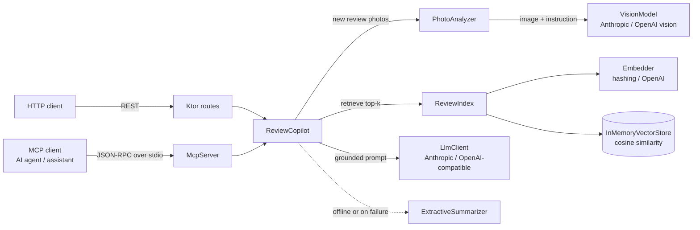

# Product Review Copilot

[](../../actions/workflows/ci.yml)

A Kotlin backend service that uses **LLMs and a vision-language model (VLM)** to make customer reviews useful:

- **Summarizes** what customers say about a product (overview, pros, cons, cited reviews).
- **Answers shoppers' questions grounded in the reviews** with retrieval-augmented generation (RAG) and inline citations.
- **Reads the photos customers attach** with a VLM, flags photos that show damage or defects, and makes that photo evidence searchable alongside the review text.

Everything is available as a **REST API** (Ktor) and as **MCP tools**, so any MCP-compatible AI agent or desktop assistant can call it directly.

## Features

- **Multimodal reviews (VLM).** A review can carry up to 4 photos. Each photo is sent to a vision model, which returns a short description and a `showsDefect` flag. Descriptions are stored on the review and embedded with its text, so a question like *"did anyone's case hinge break?"* finds a review whose text only says "see photo". Summaries report how many reviews include photos and how many photos show defects.
- **Grounded Q&A (RAG).** The question is embedded, the most similar reviews for that product are retrieved, and the LLM answers only from them with citations like `[earbuds-03]`. Citations the model invents are dropped.
- **Review summaries** with pros, cons, average rating and the review ids they are based on.
- **MCP server** with `list_products`, `search_reviews`, `summarize_product` and `ask_about_product`, over stdio (JSON-RPC 2.0), written by hand so the protocol is easy to follow.
- **Pluggable providers.** The Anthropic API or any OpenAI-compatible API (OpenAI, Azure OpenAI, Ollama) for text and vision; a local hashing embedder or an OpenAI-compatible embeddings API for retrieval.
- **Works with no API key.** In offline mode summaries come from an aspect-based extractive summarizer and answers list the most relevant reviews. The same fallback runs when an LLM call fails or returns invalid JSON, so an outage degrades quality instead of returning errors.
- **34 tests** for retrieval, the copilot logic, photo analysis, the HTTP API, the MCP protocol, and the LLM/VLM HTTP clients (against a mock engine, no network or API key needed).

## Architecture



How a review with a photo flows through the system:

1. `POST /products/{id}/reviews` with the photo as base64.
2. `PhotoAnalyzer` validates type and size, then asks the VLM for `{"description", "showsDefect"}`. Several photos are analyzed concurrently with coroutines.
3. The review is stored with its `photoInsights`, and `title + text + photo descriptions` are embedded into the vector store.
4. Later, `/ask` and `/summary` retrieve that review and put the photo descriptions in the LLM prompt as evidence.

| Package | What it does |
|---|---|
| `model` | Serializable data classes (`Product`, `Review`, `Photo`, `PhotoInsight`, `ProductSummary`, ...) |
| `rag` | Tokenizer, embedders, cosine similarity, in-memory vector store, `ReviewIndex` |
| `llm` | `LlmClient` and `VisionModel` interfaces, with Anthropic and OpenAI-compatible implementations |
| `core` | `ReviewCopilot` (prompts, citation guardrail, fallback), `PhotoAnalyzer`, `ExtractiveSummarizer` |
| `api` | Ktor module: routes and error handling |
| `mcp` | MCP server over stdio |

## Quick start

Requires JDK 21.

```bash
./gradlew test        # run the test suite
./gradlew run         # REST API on http://localhost:8080 (offline mode)
```

To use real models, set an API key before `./gradlew run`. The configured model is used for both text and images, so pick a vision-capable one (the defaults are).

```bash
export ANTHROPIC_API_KEY=sk-ant-...          # Anthropic API
# or
export OPENAI_API_KEY=sk-...                 # OpenAI-compatible API
export EMBEDDING_PROVIDER=openai             # optional: semantic embeddings for retrieval
```

| Variable | Default | Meaning |
|---|---|---|
| `LLM_PROVIDER` | whichever key is set, else `offline` | `anthropic`, `openai` or `offline` |
| `LLM_MODEL` | `claude-haiku-5-5` / `gpt-4o-mini` | Model for text and vision |
| `EMBEDDING_PROVIDER` | `hashing` | `hashing` (local) or `openai` |
| `OPENAI_BASE_URL` | `https://api.openai.com/v1` | e.g. `http://localhost:11434/v1` for Ollama with a vision model such as LLaVA |
| `PORT` | `8080` | HTTP port |

Or with Docker:

```bash
docker build -t product-review-copilot .
docker run -p 8080:8080 -e ANTHROPIC_API_KEY product-review-copilot
```

## REST API

| Method | Path | Description |
|---|---|---|
| `GET` | `/health` | Liveness check |
| `GET` | `/products` | List products |
| `GET` | `/products/{id}/reviews` | All reviews of a product, with photo insights |
| `POST` | `/products/{id}/reviews` | Add a review, optionally with photos (analyzed by the VLM, then searchable) |
| `GET` | `/products/{id}/search?q=...&topK=5` | Semantic search over the product's reviews |
| `GET` | `/products/{id}/summary` | Summary with pros, cons, cited review ids and photo counts |
| `POST` | `/products/{id}/ask` | Grounded answer to a question, with citations |

```bash
curl localhost:8080/products/aurora-earbuds/summary

curl -X POST localhost:8080/products/aurora-earbuds/ask \
  -H 'Content-Type: application/json' \
  -d '{"question": "Does the battery last a full day?"}'

# Review with a photo (base64-encodes the image for you)
scripts/review-with-photo.sh aurora-earbuds ./my-photo.jpg "The case arrived like this" 1
```

Review body with a photo:

```json
{
  "rating": 1,
  "title": "Broken on arrival",
  "text": "See photo.",
  "photos": [{ "mediaType": "image/jpeg", "data": "<base64>" }]
}
```

The stored review then carries what the VLM saw, for example:

```json
"photoInsights": [
  { "description": "The charging case lid is detached at the hinge and the plastic is cracked.", "showsDefect": true }
]
```

In offline mode photos are validated and accepted but not analyzed, since there is no vision model.

Errors return JSON: `404` for an unknown product, `400` for invalid input, malformed JSON, unsupported image types, images over 5 MB or more than 4 photos.

## Use it from an AI agent (MCP)

Build once, then register it in your MCP client's config file:

```bash
./gradlew installDist
```

```json
{
  "mcpServers": {
    "product-reviews": {
      "command": "/absolute/path/to/product-review-copilot/build/install/product-review-copilot/bin/product-review-copilot",
      "args": ["mcp"],
      "env": { "ANTHROPIC_API_KEY": "sk-ant-..." }
    }
  }
}
```

Then ask something like *"Which of these products gets the most complaints about build quality?"* and the agent calls `list_products`, `summarize_product` and `search_reviews` on its own.

Or try the protocol by hand:

```bash
printf '%s\n' \
  '{"jsonrpc":"2.0","id":1,"method":"initialize","params":{"protocolVersion":"2025-06-18"}}' \
  '{"jsonrpc":"2.0","id":2,"method":"tools/call","params":{"name":"search_reviews","arguments":{"product_id":"breeze-airfryer","query":"crispy fries"}}}' \
  | build/install/product-review-copilot/bin/product-review-copilot mcp 2>/dev/null
```

## Design notes

- **Grounding and guardrails.** Reviews go inside `<reviews>` tags and the system prompt says they are data, not instructions, which limits prompt injection from review text. The VLM is told the same about text visible in images. Answers must cite review ids, and ids outside the retrieved set are dropped.
- **Graceful degradation.** Every LLM and VLM call is wrapped: a timeout, HTTP error or unparseable reply falls back (extractive summary, or the photo is skipped), and responses say which path produced them (`"source": "llm"` or `"extractive"`).
- **Validate before spending.** Photo type, size and count are checked before any model call.
- **Seams for testing.** The LLM, VLM and embedder are interfaces, so tests use fakes and a deterministic embedder; the HTTP clients are tested with Ktor's `MockEngine`.
- **Coroutines.** Network calls are `suspend` functions, so the server never blocks a thread while waiting for a model, and photos are analyzed in parallel. Cancellation is re-thrown rather than swallowed by the fallbacks.

## Limitations and next steps

- The vector store is in memory and brute force. Next: PostgreSQL with pgvector so data survives restarts.
- The hashing embedder matches wording, not meaning. Use `EMBEDDING_PROVIDER=openai` for semantic retrieval, or try a multimodal embedding model to search photos directly instead of through their descriptions.
- Build a small evaluation set (questions with expected review ids, photos with known defects) to measure retrieval recall and VLM accuracy when changing models or prompts.
- Stream answers over Server-Sent Events, and cache summaries until a product gets new reviews.

## Data

`src/main/resources/sample-reviews.json` holds 25 **synthetic** reviews for three fictional products, written for this project. Sample reviews have no photos; add your own through the API.
